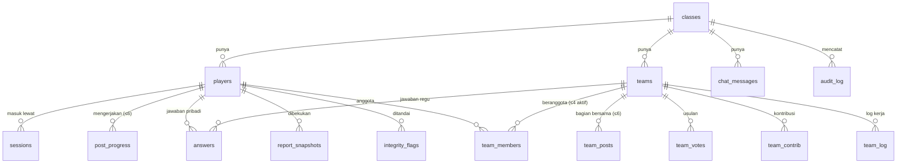

# Arsitektur Database NUTRANTARA

*Diperbarui 23 November 2026 dari kode nyata: `server.js`, `game.js`, `missions.js`, `data/classroom.json` (hanya struktur kunci, isi data siswa tidak disalin), `render.yaml`, dan `CLAUDE.md`.*

**Peta dokumen.** Dokumen ini membahas model data, skema tabel, migrasi JSON → SQLite, cadangan, PostgreSQL, dan privasi data siswa. Proses server, jaringan, integritas penilaian, deploy, dan **daftar prioritas bersama** ada di [`ARSITEKTUR_SERVER.md`](ARSITEKTUR_SERVER.md) bagian 3; dokumen ini tidak punya daftar prioritas sendiri.

## Ringkasan

1. **Database target NUTRANTARA adalah SQLite**, satu berkas di disk yang sama (`/data/nutrantara.db` di Render, `data/nutrantara.db` di laptop guru). Bukan PostgreSQL, Supabase, MongoDB, atau Redis.
2. **Selama masih satu kelas per server, tetap JSON.** Pengaman terpenting sudah masuk ke `server.js` (23 November 2026): berkas rusak tidak lagi tertimpa data kosong, dan ada cadangan bergulir tiap 30 menit.
3. **Pindah ke SQLite begitu salah satu pemicu terjadi** (bagian 5.1): nilai masuk rapor resmi, ada 4 kelas atau lebih di satu server, atau berkas JSON melewati ±5 MB / 150 akun.
4. **PostgreSQL hanya bila lebih dari satu proses server harus berbagi akun** (skala publik). Skema di sini sengaja bisa dipindah ke PostgreSQL tanpa dirancang ulang.
5. **Pakai `node:sqlite` bawaan Node.js 24 LTS**, bukan paket native, agar dependensi runtime tetap hanya `ws`. Naik dari Node 20 memang perlu (`ARSITEKTUR_SERVER.md` Fase 2.5).
6. **Data siswa tetap tanpa identitas pribadi.** Nama asli, email, NIS, dan tanggal lahir tidak pernah masuk database. Pasangan alias ↔ nama asli dipegang guru di luar server.

---

## 1. Model data sekarang

### 1.1 Satu berkas, satu objek di memori

`server.js` memuat seluruh `data/classroom.json` ke objek `db` saat mulai, mengubahnya di memori, lalu menulis ulang berkas utuh (debounce 1 detik, `classroom.json.tmp` → `rename`). Salinan bergulir disimpan di `data/backup/` (bagian 6.1). Saat ini berkas berukuran ±37 KB untuk 5 akun, 1 regu, dan 2 pesan obrolan.

```
classroom.json
├─ version: 1, createdAt
├─ settings   { paused, chatEnabled, movementLocked, openPosts[], announcement, classCode }
├─ players    { <id>: Pemain }          ← kunci objek = id acak
├─ teams      { <kode 6 huruf>: Regu }  ← kunci objek = kode undangan
└─ chat       [ Pesan ]                 ← maks. 200 terakhir
```

### 1.2 Pemain (`db.players[id]`)

| Kelompok | Kolom | Keterangan |
| :-- | :-- | :-- |
| Akun | `id`, `alias`, `aliasKey` (huruf kecil, unik), `passHash` (`scrypt$salt$hash`), `sessions[]` `{hash SHA-256, exp}` maks. 5, `color`, `createdAt` | `tokenHash` masih ada di satu akun lama, sisa format sebelum `sessions` dan tidak dipakai lagi |
| Status dunia | `x`, `y`, `h`, `zone` (`lobby`/`world`), `activePos`, `screen`, `lastSeen` | Berubah 10×/detik saat bergerak, hanya perlu tahan lama secara kasar |
| Kendali guru | `muted`, `blocked`, `flags[]` (20 terakhir, teks `waktu · pesan`) | `flags` = catatan integritas dari `validateProgress` |
| Hasil | `score`, `seals`, `finishedAt` | **Turunan**, dihitung ulang server dari `progress` |
| Regu | `team` (kode regu), `reasonSig` | `reasonSig` hanya penanda perubahan alasan |
| Progres | `progress` (seluruh state `game.js`, `SCHEMA_VERSION = 2`), `progressUpdatedAt` | 2,5–4,5 KB per siswa saat ini |

Isi `progress`:

```
progress
├─ schemaVersion: 2, appVersion, alias, currentScreen, activePos, leaderboardRecorded, updatedAt
└─ posts
   ├─ "1".."5"  (type analysis)  { started, sealed, sealedAt, reason, variant?, evidence[]?, activity?,
   │                              challenges: [ {complete, attempts, points, correct?, response, draft, log[]} ×2 ] }
   └─ "6"       (type project)   { started, sealed, sealedAt, step, reached,
                                   initial  {target, mealTime, menuName, ingredients[{name, form, grams, energy, protein, fiber, source}],
                                             rationale, missingNote, changeReason, savedAt},
                                   review   {checks[], reviewer, notes, savedAt},
                                   revision {…sama dengan initial…}, reflection {learned, contribution}, activity? }
```

Pos 1 dan Pos 2 bervarian (`variants`, nomor tersimpan di `posts[id].variant`). Jenis jawaban: `single` (string), `multi` dan `order` (larik string), `sort` (objek kategori). Skor: jawaban benar 30 poin, salah 0, segel 20 poin per pos.

### 1.3 Regu (`db.teams[kode]`)

`{ code, leaderId, members[] (maks. 4), createdAt, posts{pos: bagian bersama}, log[] (maks. 300), contrib{playerId: {pos: jumlah}} }`.

Bagian bersama per pos ditentukan `SHARED_KEYS`: untuk analisis `variant, evidence, activity, challenges, started`, untuk proyek `activity, initial, review, revision, reached, started`. Usulan jawaban yang belum terkunci ada di `posts[pos].votes[index][playerId]`. Jawaban terkunci menyimpan `by` (alias pendukung) dan `at`. Server menyalin bagian regu ke progres tiap anggota (`overlayTeam`), jadi skor anggota tetap dihitung dari progres pribadi.

### 1.4 Obrolan dan pengaturan

- `chat[]`: `{ id, from (alias), playerId, color, text ≤200, at }`, 200 terakhir.
- `settings`: satu untuk seluruh instance. `classCode` disembunyikan dari siswa (`publicSettings`).
- PIN guru **tidak** ada di berkas, hanya di variabel lingkungan `NUTRANTARA_ADMIN_PIN`.

### 1.5 Yang belum ada di model sekarang

| Kekurangan | Dampak | Ditangani di |
| :-- | :-- | :-- |
| Rapor (`evaluateAll` di `game.js`) hanya dihitung di peramban; server tidak menyimpan rapor, predikat, atau tanggalnya | Tidak ada nilai yang dibekukan untuk rapor sekolah | `report_snapshots` (3.6) |
| Tindakan guru (atur ulang, hapus, atur ulang kata sandi, keluarkan) tidak dicatat | Tidak bisa diaudit | `audit_log` (3.7) |
| Penguncian jawaban hanya di kode (`lockAnswers`), data JSON sendiri bisa diubah apa saja | Bug di kode bisa mengubah nilai tanpa jejak | `answers` + trigger (3.3) |
| Seluruh berkas ditulis ulang tiap simpan, sinkron di event loop: ±0,5 MB per tulis untuk 60 siswa, beberapa MB bila data regu mendekati batas (400 KB × 15 regu) | Wajar untuk satu kelas, tidak untuk ratusan siswa | Tulis per baris (5.2) |
| `playerBySession` dan pencarian alias memindai semua pemain | Wajar untuk 60, tidak untuk ribuan | `sessions`, `UNIQUE` alias (3.2) |
| Satu kelas per berkas | Kelas kedua butuh server kedua | `classes` (3.1) |

Alamat IP hanya ada di memori (`conns`, pembatas laju) dan tidak pernah ditulis ke berkas. Ini sudah benar dan harus dipertahankan.

---

## 2. Prinsip rancangan

1. **Memori tetap jadi sumber kebenaran saat berjalan, database untuk ketahanan.** Gerak 10×/detik, siaran, dan voting tetap memakai objek di memori seperti sekarang. Database ditulis per baris yang berubah, bukan seluruh isi. Dengan begitu logika `server.js` hampir tidak berubah.
2. **Relasional untuk yang ditanyai dan dinilai, JSON untuk isi kerja yang bentuknya bebas.** Akun, kelas, regu, jawaban terkunci, segel, rapor, dan log jadi kolom biasa. Draf, aktivitas stasiun, dan rancangan menu Pos 6 tetap kolom JSON, agar `game.js` tidak perlu ditulis ulang.
3. **Jawaban yang sudah dikunci tidak bisa diubah, juga oleh server sendiri.** Tabel `answers` hanya boleh `INSERT`, dijaga dengan trigger. Ini menegakkan "satu jawaban per tantangan" di tingkat data.
4. **Skor adalah turunan.** `players.score` dan `players.seals` hanya cache. Kebenarannya adalah view `v_player_score` dari `answers` + `post_progress.sealed`.
5. **Kelas ada sejak awal**, walau baru satu. Satu baris `classes` bernama `default` untuk instance sekarang, jadi multi-kelas nanti tidak butuh migrasi skema.
6. **Siap pindah ke PostgreSQL**: id `TEXT`, waktu ISO 8601 UTC, JSON sebagai `TEXT` yang valid (di PostgreSQL menjadi `jsonb`), tanpa fitur khusus SQLite selain trigger sederhana.

---

## 3. Skema tabel usulan (SQLite)

Pengaturan koneksi, dijalankan setiap kali database dibuka:

```sql
PRAGMA journal_mode = WAL;       -- baca tidak menunggu tulis, aman bila proses mati
PRAGMA synchronous = NORMAL;     -- cukup aman dengan WAL, jauh lebih cepat dari FULL
PRAGMA foreign_keys = ON;
PRAGMA busy_timeout = 3000;
```

### 3.1 Meta dan kelas

```sql
CREATE TABLE schema_meta (
  key   TEXT PRIMARY KEY,          -- 'schema_version', 'migrated_from', 'migrated_at'
  value TEXT NOT NULL
);

CREATE TABLE classes (
  id             TEXT PRIMARY KEY,           -- 'default' untuk instance satu kelas
  name           TEXT NOT NULL,              -- mis. 'XI MIPA 2 · Ganjil 2026'
  join_code      TEXT,                       -- settings.classCode, syarat daftar (boleh kosong)
  admin_pin_hash TEXT,                       -- scrypt; NULL = pakai NUTRANTARA_ADMIN_PIN
  settings_json  TEXT NOT NULL DEFAULT '{}', -- paused, chatEnabled, movementLocked, openPosts, announcement
  created_at     TEXT NOT NULL,
  archived_at    TEXT,                       -- kelas selesai: hanya baca, menunggu dihapus
  purge_after    TEXT                        -- tanggal hapus otomatis (bagian 8.3)
);
CREATE UNIQUE INDEX classes_join_code ON classes(lower(join_code)) WHERE join_code IS NOT NULL AND join_code <> '';
```

### 3.2 Akun dan sesi

```sql
CREATE TABLE players (
  id             TEXT PRIMARY KEY,
  class_id       TEXT NOT NULL REFERENCES classes(id) ON DELETE CASCADE,
  alias          TEXT NOT NULL,              -- 3–20 karakter, bukan nama lengkap (USERNAME_RE)
  alias_key      TEXT NOT NULL,              -- alias huruf kecil
  pass_hash      TEXT,                       -- 'scrypt$salt$hash'; NULL = harus diatur ulang guru
  color          TEXT NOT NULL,
  created_at     TEXT NOT NULL,
  last_seen      TEXT,
  muted          INTEGER NOT NULL DEFAULT 0,
  blocked        INTEGER NOT NULL DEFAULT 0,
  -- status dunia: ditulis saat keluar / tiap ±30 detik, bukan tiap gerak
  pos_x REAL, pos_y REAL, pos_h REAL, zone TEXT, active_pos INTEGER, screen TEXT,
  -- versi state klien (game.js SCHEMA_VERSION / APP_VERSION)
  schema_version INTEGER, app_version TEXT, current_screen TEXT,
  -- cache turunan, kebenaran di v_player_score
  score          INTEGER NOT NULL DEFAULT 0,
  seals          INTEGER NOT NULL DEFAULT 0,
  finished_at    TEXT,
  UNIQUE (class_id, alias_key)
);

CREATE TABLE sessions (
  token_hash TEXT PRIMARY KEY,               -- SHA-256 token, token asli tidak pernah disimpan
  player_id  TEXT NOT NULL REFERENCES players(id) ON DELETE CASCADE,
  created_at TEXT NOT NULL,
  expires_at TEXT NOT NULL                   -- 30 hari (SESSION_DAYS)
);
CREATE INDEX sessions_player ON sessions(player_id);
```

`sessions.token_hash` sebagai kunci utama menggantikan pemindaian `playerBySession`. Batas 5 sesi per akun tetap ditegakkan di kode (hapus yang tertua).

**Catatan multi-kelas:** alias cukup unik per kelas. Begitu ada lebih dari satu kelas di server, layar masuk perlu kode kelas (sudah ada di layar daftar). Selama hanya kelas `default`, perilaku masuk tidak berubah.

### 3.3 Progres per pos dan jawaban

```sql
CREATE TABLE post_progress (
  player_id   TEXT    NOT NULL REFERENCES players(id) ON DELETE CASCADE,
  pos_id      INTEGER NOT NULL CHECK (pos_id BETWEEN 1 AND 6),
  started     INTEGER NOT NULL DEFAULT 0,
  variant     INTEGER,                       -- Pos 1/2; ditetapkan sekali (trigger di bawah)
  sealed      INTEGER NOT NULL DEFAULT 0,
  sealed_at   TEXT,
  reason      TEXT,                          -- alasan Paspor Pos 1–5, ≤1200 karakter
  state_json  TEXT NOT NULL DEFAULT '{}',    -- sisa state pos: draft, log, activity, evidence,
                                             -- step/reached/initial/review/revision/reflection (Pos 6)
  updated_at  TEXT NOT NULL,
  PRIMARY KEY (player_id, pos_id)
);

CREATE TRIGGER post_variant_fixed BEFORE UPDATE OF variant ON post_progress
WHEN OLD.variant IS NOT NULL AND NEW.variant IS NOT OLD.variant
BEGIN SELECT RAISE(ABORT, 'varian pos sudah ditetapkan'); END;

CREATE TABLE answers (
  id              INTEGER PRIMARY KEY,
  player_id       TEXT REFERENCES players(id) ON DELETE CASCADE,  -- jawaban pribadi, atau
  team_id         TEXT REFERENCES teams(id)   ON DELETE CASCADE,  -- jawaban regu (hasil voting)
  pos_id          INTEGER NOT NULL CHECK (pos_id BETWEEN 1 AND 5),
  variant         INTEGER,
  challenge_index INTEGER NOT NULL CHECK (challenge_index >= 0),
  response_json   TEXT NOT NULL,             -- string / larik / objek sesuai type
  correct         INTEGER NOT NULL,          -- dihitung server dengan isCorrect, bukan klaim klien
  points          INTEGER NOT NULL,          -- 30 atau 0
  locked_at       TEXT NOT NULL,
  locked_by_json  TEXT,                      -- regu: alias pendukung (field `by` sekarang)
  CHECK ((player_id IS NULL) <> (team_id IS NULL)),
  UNIQUE (player_id, pos_id, challenge_index),
  UNIQUE (team_id,   pos_id, challenge_index)
);
CREATE INDEX answers_team ON answers(team_id) WHERE team_id IS NOT NULL;

CREATE TRIGGER answers_immutable BEFORE UPDATE ON answers
BEGIN SELECT RAISE(ABORT, 'jawaban yang sudah dikunci tidak bisa diubah'); END;
```

Keputusan penting:

- **Jawaban yang terkunci keluar dari JSON** dan masuk `answers`. Aturannya sama dengan `lockAnswers` yang sudah berjalan di `server.js`; tabel ini menambahkan jaring pengaman di tingkat data. Draf dan `log` per tantangan tetap di `state_json`. Saat server mengirim progres ke klien, `answers` disusun kembali ke bentuk `challenges[]` yang sama, jadi `game.js` tidak berubah.
- **Pemain dalam regu memakai jawaban regunya** (`team_id`), persis seperti `overlayTeam` sekarang. Skor anggota dihitung dari jawaban regu untuk pos yang dikerjakan regu.
- **Mengulang pos oleh guru** (aksi `reset`) menghapus baris `answers` milik siswa itu lewat `DELETE`, dan tindakan itu tercatat di `audit_log`. Trigger hanya mencegah *mengubah* jawaban, bukan menghapus atas perintah guru.
- `attempts` tidak disimpan. Sejak 0.7 setiap tantangan dijawab sekali, jadi nilainya selalu 1.

### 3.4 Regu

```sql
CREATE TABLE teams (
  id           TEXT PRIMARY KEY,
  class_id     TEXT NOT NULL REFERENCES classes(id) ON DELETE CASCADE,
  code         TEXT NOT NULL,                -- kode undangan 6 karakter
  leader_id    TEXT REFERENCES players(id) ON DELETE SET NULL,
  created_at   TEXT NOT NULL,
  dissolved_at TEXT,                         -- regu bubar disimpan untuk riwayat nilai
  UNIQUE (class_id, code)
);

CREATE TABLE team_members (
  team_id   TEXT NOT NULL REFERENCES teams(id)   ON DELETE CASCADE,
  player_id TEXT NOT NULL REFERENCES players(id) ON DELETE CASCADE,
  joined_at TEXT NOT NULL,
  left_at   TEXT,
  PRIMARY KEY (team_id, player_id)
);
CREATE UNIQUE INDEX one_active_team ON team_members(player_id) WHERE left_at IS NULL;

CREATE TABLE team_posts (
  team_id     TEXT    NOT NULL REFERENCES teams(id) ON DELETE CASCADE,
  pos_id      INTEGER NOT NULL CHECK (pos_id BETWEEN 1 AND 6),
  started     INTEGER NOT NULL DEFAULT 0,
  variant     INTEGER,
  shared_json TEXT NOT NULL DEFAULT '{}',    -- evidence, activity, initial/review/revision/reached (Pos 6)
  updated_at  TEXT NOT NULL,
  PRIMARY KEY (team_id, pos_id)
);

CREATE TABLE team_votes (                    -- usulan jawaban yang belum terkunci
  team_id         TEXT    NOT NULL REFERENCES teams(id)   ON DELETE CASCADE,
  pos_id          INTEGER NOT NULL,
  challenge_index INTEGER NOT NULL,
  player_id       TEXT    NOT NULL REFERENCES players(id) ON DELETE CASCADE,
  response_json   TEXT    NOT NULL,
  voted_at        TEXT    NOT NULL,
  PRIMARY KEY (team_id, pos_id, challenge_index, player_id)
);

CREATE TABLE team_contrib (                  -- angka kontribusi untuk panel guru
  team_id   TEXT    NOT NULL REFERENCES teams(id)   ON DELETE CASCADE,
  player_id TEXT    NOT NULL REFERENCES players(id) ON DELETE CASCADE,
  pos_id    INTEGER NOT NULL,
  count     INTEGER NOT NULL DEFAULT 0,
  PRIMARY KEY (team_id, player_id, pos_id)
);
```

`team_members.left_at` menggantikan "keluar regu = hilang dari larik". Riwayat siapa yang ikut mengunci jawaban tetap ada setelah anggota keluar, dan ini perlu untuk penilaian proyek kelompok.

### 3.5 Skor (view, bukan tabel)

```sql
CREATE VIEW v_player_answers AS
  -- jawaban pribadi
  SELECT a.player_id, a.pos_id, a.challenge_index, a.correct, a.points
  FROM answers a WHERE a.player_id IS NOT NULL
  UNION ALL
  -- jawaban regu, berlaku untuk anggota yang masih aktif
  SELECT m.player_id, a.pos_id, a.challenge_index, a.correct, a.points
  FROM answers a JOIN team_members m ON m.team_id = a.team_id AND m.left_at IS NULL;

CREATE VIEW v_player_score AS
  SELECT p.id AS player_id, p.class_id, p.alias,
         COALESCE((SELECT SUM(points) FROM v_player_answers x WHERE x.player_id = p.id), 0)
       + 20 * (SELECT COUNT(*) FROM post_progress s WHERE s.player_id = p.id AND s.sealed = 1) AS score,
         (SELECT COUNT(*) FROM post_progress s WHERE s.player_id = p.id AND s.sealed = 1) AS seals
  FROM players p;
```

Papan skor dan panel guru tetap membaca cache di memori (`players.score`). View ini dipakai untuk pemeriksaan: uji otomatis dan migrasi membandingkan cache dengan view, dan selisih berarti ada bug.

> Aturan jawaban regu saat anggota pindah regu sengaja belum diputuskan di sini. Sekarang progres anggota yang keluar menyimpan salinan terakhir bagian regu. Bila perilaku itu harus dipertahankan, salin baris `answers` regu menjadi jawaban pribadi saat anggota keluar. Putuskan ini bersama guru sebelum implementasi.

### 3.6 Rapor

```sql
CREATE TABLE report_snapshots (
  id           INTEGER PRIMARY KEY,
  player_id    TEXT NOT NULL REFERENCES players(id) ON DELETE CASCADE,
  kind         TEXT NOT NULL CHECK (kind IN ('akhir', 'guru')),
                                             -- akhir: otomatis saat 6 segel; guru: dibekukan guru
  score        INTEGER NOT NULL,
  max_score    INTEGER NOT NULL,
  pct          INTEGER NOT NULL,
  grade        TEXT NOT NULL CHECK (grade IN ('A', 'B', 'C', 'D')),  -- predikat() di game.js
  correct      INTEGER NOT NULL,
  total_q      INTEGER NOT NULL,
  seals        INTEGER NOT NULL,
  detail_json  TEXT NOT NULL,                -- per pos: skor, level, checklist Pos 6, skill
  app_version  TEXT NOT NULL,                -- versi kunci jawaban saat dibekukan
  created_at   TEXT NOT NULL,
  created_by   TEXT NOT NULL                 -- 'system' atau 'admin'
);
CREATE INDEX report_player ON report_snapshots(player_id, created_at);
```

Rapor sementara tetap dihitung langsung di peramban seperti sekarang. Yang disimpan hanya **rapor yang dibekukan**: otomatis saat siswa menyegel pos keenam (`finishedAt`), atau saat guru menekan "bekukan nilai" sebelum memindahkan nilai ke rapor sekolah. Perhitungan `evaluateAll` perlu dipindah atau disalin ke server agar hasilnya tidak bergantung pada klien. Snapshot menyimpan `app_version`, sehingga nilai lama tetap bisa dijelaskan walau soal `missions.js` berubah semester depan.

### 3.7 Obrolan dan log

```sql
CREATE TABLE chat_messages (
  id         TEXT PRIMARY KEY,
  class_id   TEXT NOT NULL REFERENCES classes(id) ON DELETE CASCADE,
  player_id  TEXT REFERENCES players(id) ON DELETE SET NULL,
  alias      TEXT NOT NULL,                  -- salinan alias saat mengirim
  text       TEXT NOT NULL,                  -- ≤200 karakter
  sent_at    TEXT NOT NULL,
  deleted_at TEXT                            -- dihapus guru: teks dikosongkan, baris tetap
);
CREATE INDEX chat_class_time ON chat_messages(class_id, sent_at);

CREATE TABLE team_log (                      -- log kerja regu (sekarang team.log, 300 terakhir)
  id        INTEGER PRIMARY KEY,
  team_id   TEXT NOT NULL REFERENCES teams(id) ON DELETE CASCADE,
  player_id TEXT REFERENCES players(id) ON DELETE SET NULL,
  alias     TEXT NOT NULL,
  pos_id    INTEGER NOT NULL DEFAULT 0,
  text      TEXT NOT NULL,                   -- ≤100 karakter
  at        TEXT NOT NULL
);
CREATE INDEX team_log_team ON team_log(team_id, at);

CREATE TABLE integrity_flags (               -- sekarang players.flags (20 terakhir)
  id        INTEGER PRIMARY KEY,
  player_id TEXT NOT NULL REFERENCES players(id) ON DELETE CASCADE,
  pos_id    INTEGER,
  text      TEXT NOT NULL,                   -- mis. 'segel tidak memenuhi syarat dan dibatalkan'
  at        TEXT NOT NULL
);
CREATE INDEX flags_player ON integrity_flags(player_id, at);

CREATE TABLE audit_log (                     -- BARU: tindakan guru dan sistem
  id        INTEGER PRIMARY KEY,
  class_id  TEXT NOT NULL REFERENCES classes(id) ON DELETE CASCADE,
  actor     TEXT NOT NULL,                   -- 'admin', 'system', 'migrasi'
  action    TEXT NOT NULL,                   -- reset, delete, reset-password, kick, unblock, mute,
                                             -- set-class-code, team-dissolve, export, freeze-report, restore
  target_id TEXT,                            -- id pemain / kode regu; tidak pakai FK agar log tetap ada
  target_alias TEXT,                         -- dikosongkan saat siswa dihapus (bagian 8.4)
  detail    TEXT,                            -- tanpa kata sandi, tanpa PIN, tanpa IP
  at        TEXT NOT NULL
);
CREATE INDEX audit_class_time ON audit_log(class_id, at);
```

Log tidak menyimpan alamat IP. Pembatas laju tetap di memori seperti sekarang.

### 3.8 Perkiraan ukuran

| Isi | 1 kelas (60 siswa) | 10 kelas (600 siswa) |
| :-- | :-- | :-- |
| `players` + `sessions` | ±60 KB | ±600 KB |
| `post_progress` (state ±3–5 KB per siswa) | ±300 KB | ±3 MB |
| `answers` (10 per siswa) | ±60 KB | ±600 KB |
| `team_*`, log, obrolan, rapor | ±300 KB | ±3 MB |
| **Total** | **< 1 MB** | **±10 MB** |

Disk Render 1 GB cukup untuk database, 48 cadangan bergulir, dan cadangan harian bertahun-tahun.

---

## 4. Diagram relasi



Versi teks:

```
classes ─┬─< players ─┬─< sessions
         │            ├─< post_progress (player, pos 1–6)
         │            ├─< answers ............ (player | team, pos 1–5, tantangan) — tidak bisa diubah
         │            ├─< report_snapshots
         │            └─< integrity_flags
         ├─< teams ───┬─< team_members >── players   (satu regu aktif per pemain)
         │            ├─< team_posts (team, pos)
         │            ├─< answers
         │            ├─< team_votes, team_contrib, team_log
         ├─< chat_messages
         └─< audit_log
```

---

## 5. Strategi migrasi JSON → SQLite

### 5.1 Kapan

Tetap JSON sampai **salah satu** terjadi:

| Pemicu | Kenapa SQLite menyelesaikannya |
| :-- | :-- |
| Nilai NUTRANTARA akan masuk rapor resmi (bersamaan dengan Fase 1.5 `ARSITEKTUR_SERVER.md`) | `answers` tidak bisa diubah, rapor dibekukan, `audit_log` mencatat tindakan guru |
| 4 kelas atau lebih di satu server (Fase 4) | `class_id` di setiap tabel, tulis per baris |
| `classroom.json` > ±5 MB atau > 150 akun | Tulis ulang berkas utuh tiap detik mulai mengganggu siaran 100 ms |

Sebelum pemicu itu, JSON dengan pengaman bagian 6.1 sudah cukup. Jangan migrasi di tengah semester yang sedang berjalan; pilih masa libur atau awal semester.

### 5.2 Cara: ganti lapisan simpan, bukan logika game

1. **Pastikan Node.js 24 LTS sudah dipakai** (`ARSITEKTUR_SERVER.md` Fase 2.5), termasuk di laptop guru mode LAN. Pastikan `node:sqlite` berjalan tanpa flag pada versi yang dipilih; bila tidak, cadangannya `better-sqlite3` (paket native dengan biner siap pakai untuk Windows dan Alpine).
2. **Buat `storage.js`** (dimuat `server.js`) dengan antarmuka kecil: `load() → db`, `markDirty(jenis, id)`, `flush()`, `backup()`, `close()`. Implementasi pertama membungkus perilaku JSON sekarang, jadi tidak ada perubahan perilaku. Implementasi kedua memakai SQLite.
3. **Di mode SQLite, objek `db` tetap ada di memori.** `load()` menyusunnya dari tabel saat mulai. Setiap handler yang sekarang memanggil `scheduleSave()` juga menandai baris yang berubah (`markDirty('player', id)`, `markDirty('team', code)`, `markDirty('chat', id)`). Tiap 1 detik, `flush()` menulis hanya baris kotor dalam satu transaksi. Posisi (`x`, `y`, `h`, `zone`) ditulis saat pemain keluar dan tiap ±30 detik, bukan tiap gerak.
4. **Penguncian jawaban di kode tetap wajib.** `lockAnswers` tetap berjalan seperti sekarang; saat `handleProgress` atau `handleTeamVote` mengunci jawaban baru, server memanggil `INSERT INTO answers`. Trigger `answers_immutable` dan `UNIQUE` adalah jaring pengaman terakhir: bila kode keliru mencoba mengubah jawaban, tulisannya gagal dan tercatat di log server.
5. **Pilih mode lewat variabel lingkungan** `NUTRANTARA_STORAGE=json|sqlite`. Satu rilis memakai `json` sebagai bawaan (SQLite bisa dicoba), rilis berikutnya `sqlite`.
6. **`test/smoke.js` dijalankan dua kali**, sekali per mode, dengan asersi tambahan: data bertahan setelah server dimatikan dan dinyalakan lagi, jawaban terkunci tidak bisa diganti, dan `players.score` sama dengan `v_player_score`.

### 5.3 Skrip impor satu kali

`scripts/import-json.js` (dijalankan server saat pertama kali mode `sqlite` menemukan `classroom.json` tanpa `nutrantara.db`):

1. Salin `classroom.json` ke `backup/classroom-pra-migrasi-<waktu>.json`. Berkas asli tidak diubah.
2. Buat skema dan satu baris `classes` `default` dari `settings` (`classCode` → `join_code`).
3. Per pemain: `players` (tanpa `tokenHash` lama), `sessions` dari `sessions[]` yang belum kedaluwarsa, satu `post_progress` per pos. Tantangan yang `complete` dengan `response` masuk `answers`, dengan `correct`/`points` **dihitung ulang** memakai `isCorrect`. `flags[]` dipecah menjadi `integrity_flags`.
4. Per regu: `teams`, `team_members`, `team_posts`, jawaban regu terkunci ke `answers` (dengan `by` → `locked_by_json`), `votes` → `team_votes`, `contrib` → `team_contrib`, `log` → `team_log`.
5. Obrolan → `chat_messages`.
6. **Verifikasi dalam transaksi yang sama**: jumlah pemain, regu, anggota, dan pesan sama dengan JSON; untuk setiap pemain, skor dan segel dari `validateProgress(json)` sama dengan `v_player_score`. Bila ada satu saja yang berbeda, batalkan transaksi, server tetap memakai JSON, dan tulis laporan selisih ke log.
7. Bila lolos: tulis `schema_meta` (`migrated_from = classroom.json`, `migrated_at`), catat `audit_log` aksi `migrasi`, lalu ganti nama berkas JSON menjadi `classroom.migrated-<tanggal>.json` (hanya baca, dihapus manual setelah satu semester).

### 5.4 Jalan kembali

- Aksi guru "ekspor penuh" menulis database kembali ke format `classroom.json` versi 1 (tanpa hash kata sandi dan sesi, seperti `export` sekarang, ditambah format lengkap khusus untuk pemulihan yang menyertakannya dan hanya disimpan di `/data/backup`).
- Mundur ke mode `json` = jalankan ekspor penuh, set `NUTRANTARA_STORAGE=json`, restart. Uji jalan kembali ini sekali sebelum migrasi produksi.

### 5.5 Perubahan skema berikutnya

Satu angka `schema_meta.schema_version` dan daftar migrasi berurutan di `storage.js` (`migrations[2] = 'ALTER TABLE …'`). Saat server mulai: buat cadangan, jalankan migrasi yang belum ada dalam satu transaksi, naikkan versi. Tanpa alat migrasi pihak ketiga.

---

## 6. Cadangan dan pemulihan

### Sasaran

| Ukuran | Sasaran |
| :-- | :-- |
| Kehilangan data saat proses mati mendadak | ≤ 1 detik (sama dengan sekarang) |
| Kehilangan data saat berkas rusak | ≤ 30 menit (cadangan bergulir) |
| Waktu pulih | ≤ 10 menit, bisa dilakukan guru dengan panduan |
| Cadangan di luar server | Setidaknya mingguan, disimpan guru |

### 6.1 Sekarang (JSON)

| Lapisan | Status |
| :-- | :-- |
| Berkas rusak diganti nama `classroom.corrupt-<waktu>.json`, cadangan terbaru yang sah dipulihkan, `/health` melaporkan `recovery` | ✅ Sudah di `server.js` (`loadDb`) |
| Cadangan bergulir saat mulai, tiap 30 menit bila ada perubahan, dan saat server berhenti, ke `data/backup/classroom-<YYYYMMDD-HHmmss>.json`, 48 terakhir (`NUTRANTARA_BACKUP_KEEP`) | ✅ Sudah di `server.js` (`backupDb`) |
| Snapshot disk Render harian, disimpan 7 hari | ✅ Aktif lewat `render.yaml` |
| Satu cadangan per hari disimpan 14 hari (48 berkas bergulir hanya mencakup ±24 jam) | Belum |
| Ekspor guru mingguan dari panel admin, disimpan di laptop atau penyimpanan sekolah | Kebiasaan guru, perlu ditulis di panduan |

### 6.2 Setelah SQLite

1. **Cadangan konsisten tanpa menghentikan server:** `VACUUM INTO '/data/backup/nutrantara-<YYYYMMDD-HHmm>.db'` setiap 30 menit dan saat server mati. Jangan menyalin berkas `.db` mentah selagi berjalan (berkas `-wal` bisa tertinggal).
2. **Retensi:** 48 cadangan bergulir + 1 per hari selama 14 hari + 1 per minggu selama semester berjalan. Untuk 60 siswa ini hanya puluhan MB.
3. **Pemeriksaan saat mulai:** `PRAGMA quick_check`. Bila gagal, ganti nama berkas rusak, pulihkan cadangan terbaru yang lolos pemeriksaan, catat di `audit_log` dan `/health`.
4. **Pemulihan oleh guru:** daftar cadangan di panel admin dengan tombol "pulihkan" (server membuat cadangan dulu dari kondisi sekarang, lalu mengganti database dan memuat ulang). Di mode LAN cukup menyalin berkas cadangan ke `data/nutrantara.db` saat server mati.
5. **Latihan pulih sekali per semester**: pulihkan cadangan ke laptop dengan `npm start`, pastikan akun bisa masuk dan nilai sama.
6. **Cadangan di luar server** tetap ekspor guru mingguan. Jangan menambah unggahan otomatis ke layanan awan pihak ketiga tanpa keputusan sekolah, karena itu memindahkan data siswa ke tempat baru.

---

## 7. Kapan perlu PostgreSQL

**Tidak untuk Fase 1–4.** SQLite di satu proses sanggup menangani ratusan siswa daring dan ribuan akun untuk game dengan pola tulis seperti ini, dan tidak butuh layanan, kata sandi, atau biaya tambahan.

PostgreSQL baru diperlukan bila **semua** ini benar:

1. Ada keputusan resmi membuka NUTRANTARA lintas sekolah atau ke umum (Fase 5, misalnya target 3.000 pengguna yang pernah dibahas di `MEMORY.md`).
2. Kelas harus dibagi ke lebih dari satu proses atau server, sehingga akun dan nilai harus terlihat dari semua proses.
3. Butuh deploy tanpa jeda atau ketersediaan tinggi (disk Render hanya bisa dipasang ke satu instance).

Bila saat itu tiba:

- Pakai PostgreSQL terkelola di region terdekat dengan siswa (Singapura atau Jakarta, lihat bagian 8.5 soal lokasi data).
- Skema bagian 3 dipindah hampir apa adanya: `TEXT` JSON → `jsonb`, `INTEGER` 0/1 → `boolean`, waktu → `timestamptz`, trigger `RAISE(ABORT)` → fungsi `plpgsql` yang `RAISE EXCEPTION`.
- Status dunia dan voting tetap di memori proses yang memegang kelas itu (perutean lengket per `class_id`). PostgreSQL tetap hanya lapisan ketahanan, bukan jalur 10×/detik.
- Redis tetap tidak perlu selama satu kelas dilayani satu proses.

---

## 8. Privasi data siswa

Sebagian besar siswa SMA berusia di bawah 18 tahun, jadi dalam UU No. 27 Tahun 2022 tentang Pelindungan Data Pribadi (UU PDP) data mereka termasuk data anak yang butuh perlindungan khusus dan persetujuan orang tua/wali. Bagian ini adalah rancangan teknis, bukan nasihat hukum; untuk penggunaan resmi, sekolah perlu memastikannya dengan pihak berwenang.

### 8.1 Minimalkan data (aturan yang tidak boleh dilanggar)

| Disimpan | Tidak pernah disimpan |
| :-- | :-- |
| Alias 3–20 karakter, warna avatar | Nama lengkap, NIS/NISN, email, nomor HP, tanggal lahir, foto |
| Hash kata sandi scrypt, hash token sesi | Kata sandi atau token asli |
| Jawaban, alasan, refleksi, rancangan menu | Alamat IP, lokasi, informasi perangkat |
| Obrolan kelas (dibatasi waktu) | Rekaman suara atau kamera |

- Daftar alias ↔ nama asli dipegang guru di luar server (lembar kerja sekolah). Server tidak pernah butuh nama asli untuk bekerja.
- Pesan "Jangan pakai nama lengkap" pada layar daftar dipertahankan. Panel guru sebaiknya menyediakan tombol "ganti alias" untuk alias yang ternyata berupa nama lengkap.
- Kolom teks bebas (alasan Paspor, refleksi, obrolan) bisa berisi data pribadi yang diketik siswa. Batasi panjangnya (sudah ada) dan ingatkan di petunjuk kelas.

### 8.2 Akses

- Siswa hanya melihat alias, warna, posisi, segel, dan skor siswa lain (`publicPlayer`, `leaderboard`), dan alasan Paspor anggota regunya untuk telaah sejawat. Pertahankan batas ini di setiap fitur baru.
- Guru masuk dengan PIN. Setelah multi-kelas, PIN per kelas disimpan sebagai hash scrypt di `classes.admin_pin_hash`, bukan teks biasa. Setiap tindakan guru tercatat di `audit_log`.
- Ekspor guru tetap membuang `passHash`, `sessions`, dan `aliasKey` seperti sekarang. Untuk penelitian, sediakan ekspor anonim: id diganti kode acak dan alias dihapus.
- Berkas database dan cadangan hanya ada di disk server (`/data`) atau folder `data/` laptop guru, dan keduanya tidak boleh masuk Git (sudah `gitignore`). Ekspor yang dibawa keluar server sebaiknya disimpan dalam arsip berkata sandi.

### 8.3 Masa simpan

| Data | Masa simpan |
| :-- | :-- |
| Sesi kedaluwarsa | Dihapus otomatis saat server mulai dan tiap hari |
| Obrolan | 30 hari, atau sampai guru mengosongkan; maks. 200 pesan ditampilkan |
| `team_log`, `integrity_flags`, `audit_log` | Sampai kelas dihapus |
| Kelas yang selesai | Guru menekan "arsipkan kelas" di akhir semester (ekspor + hanya baca), lalu data dihapus otomatis pada `purge_after`, **paling lama 12 bulan** setelah diarsipkan |
| Cadangan | Ikut terhapus sesuai retensi bagian 6 (paling lama satu semester) |

### 8.4 Hak menghapus

Aksi guru `delete` (dan permintaan siswa/orang tua lewat guru) harus menghapus tuntas:

- `players` beserta `sessions`, `post_progress`, `answers` pribadi, `report_snapshots`, `integrity_flags` (lewat `ON DELETE CASCADE`).
- Di `chat_messages`, `team_log`, dan `audit_log`, alias dan teks siswa itu dikosongkan, bukan sekadar diputus relasinya.
- Jawaban regu tetap ada karena milik anggota lain, tetapi nama siswa itu dihapus dari `locked_by_json`.
- Sampaikan ke guru bahwa salinan di cadangan baru hilang setelah masa retensi cadangan habis.

### 8.5 Lokasi data

Server Render ada di Singapura, jadi data siswa disimpan di luar Indonesia. UU PDP mengatur syarat transfer data ke luar negeri. Untuk uji coba kelas dengan alias saja, risikonya kecil, tetapi **sebelum dipakai untuk nilai resmi atau lintas sekolah**, ini keputusan pemilik proyek dan sekolah: tetap di Singapura dengan dasar yang jelas, atau pindah ke server di Indonesia. Mode LAN (laptop guru) menyimpan semua data di sekolah dan tidak punya masalah ini.

### 8.6 Persetujuan

Sediakan satu paragraf pemberitahuan untuk orang tua/wali: data apa yang disimpan (alias, jawaban, obrolan kelas), untuk apa (pembelajaran dan penilaian Biologi), di mana, berapa lama, dan cara meminta penghapusan lewat guru. Paragraf yang sama ditampilkan ringkas di layar daftar.

---

## 9. Yang tidak direkomendasikan

| Usulan | Alasan ditolak |
| :-- | :-- |
| PostgreSQL / Supabase sekarang | Layanan, biaya, dan titik gagal tambahan untuk data di bawah 1 MB |
| MongoDB / Firebase | Tidak memberi kunci jawaban yang tidak bisa diubah dan relasi regu; data siswa pindah ke layanan pihak ketiga |
| Menormalkan seluruh state `game.js` ke tabel | Memaksa menulis ulang `game.js` dan `quest.js` tanpa manfaat penilaian; draf dan aktivitas cukup JSON |
| Menulis posisi 10×/detik ke database | Posisi hanya perlu bertahan kasar; tetap di memori |
| ORM (Prisma, Sequelize, TypeORM) | Menambah dependensi besar untuk ±15 tabel; SQL langsung lebih mudah diperiksa |
| Menyimpan IP atau identitas perangkat untuk audit | Bertentangan dengan minimalisasi data anak; audit cukup mencatat tindakan guru |
